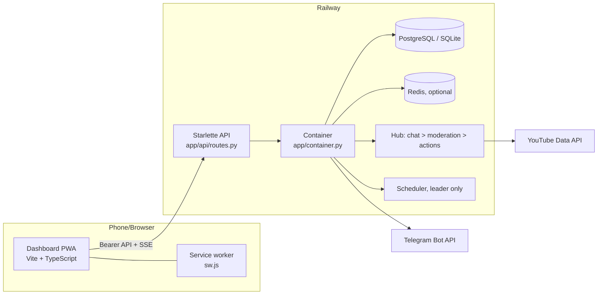

# SavahBot Atlas

The map of the whole project: where things live, how they connect, and where to change what. Updated with every change; if the code and this page disagree, fix this page.

> Status: skeleton written at the start of 1.2.0 from the 1.1.9 structure. Sections marked **(growing)** are filled in as each subsystem lands.

## 1. The big picture

ASCII fallback: `Dashboard (Vercel) <-> API (Railway) <-> DB / Redis; API <-> YouTube, Telegram`.

## 2. Repository tree
| Path | Purpose |
|---|---|
| `backend/app/main.py` | ASGI entry (`create_app`), CORS, lifespan |
| `backend/app/container.py` | Builds and wires every service; start/stop order |
| `backend/app/config.py` | One `FIELDS` table: env vars, defaults, descriptions; generates `.env.example` |
| `backend/app/runtime_config.py` | Dashboard-editable overrides of settings (table `settings`) |
| `backend/app/db.py` | SQLite/PostgreSQL layer, `SCHEMA`, **`register_schema` / `register_step`** (1.2.0 migrations) |
| `backend/app/store.py` | Queries for commands, timers, chat, actions, retention purge |
| `backend/app/security.py` | Owner auth and login throttle |
| `backend/app/shared.py` | Tiny Redis client, in-memory fallback, leader election, cache |
| `backend/app/events.py` | In-process event bus (+ Redis fan-out) feeding SSE |
| `backend/app/hub.py` | Chat pipeline: message > moderation > action |
| `backend/app/moderation/` | Scoring engine, trackers, text normalisation |
| `backend/app/intel/` | Knowledge: packs, detectors, learning |
| `backend/app/commands/` | Chat commands, triggers, variables |
| `backend/app/services/` | YouTube, Telegram, scheduler, demo source |
| `backend/app/api/` | Route registry (`R.add`), pydantic schemas |
| `backend/tests/` | pytest suite |
| `frontend/src/` | Dashboard: `main.ts` shell/router, `pages/`, `charts.ts`, `icons.ts`, CSS tokens in `styles.css` |
| `frontend/public/` | `sw.js`, manifest, icons, offline page |
| `docs/` | Guides (this folder) |

## 3. Start-up order (Container.start)
`db.connect` (schema + migrations) > `cfg.load` > `auth.init` > regulars > seed > intel > blacklist > quota > `shared.start` > `leader.start` (leader runs `_lead`: restore state, hub mode, scheduler, Telegram).

## 4. Request lifecycle
`R.add(path, methods, public)` wraps the handler: bearer check > handler > JSON. Errors become `{"error": message}` with 401/403/404/422/429/500.

## 5-13 (growing)
Event flow, database map, Redis key map, API map, frontend map, state machines, config map, "where do I change X", and the 1.1.9 > 1.2.0 history are added as each subsystem is built.

## Knowledge map (updated at CPK)
| Piece | Where |
|---|---|
| Packs (JSON, `scams/more.json` and `spam/more.json` merged from 1.1.9) | `backend/app/intel/packs/` |
| Engine, detectors | `intel/core.py`, `match.py`, `links.py`, `bayes.py` |
| Lesson ledger and Learning 2.0 | `intel/lessons.py`, `intel/learning.py` |
| Pack health, hits, bundle | `intel/tools.py` |
| Feeds | `intel/feeds.py` |
| API | `api/knowledge_routes.py` |
| UI | `frontend/src/pages/knowledge*.ts`, `knowledge.css` |
| Tables | `knowledge_*`, `learning_lessons`, `learning_snapshots` (legacy `intel_*` kept and migrated) |

## Ban management map (CPB)
| Piece | Where |
|---|---|
| Ledger table `bans`, softening rules | `backend/app/moderation/bans.py` |
| Rules applied | `hub.py` `_handle_verdict` (before the action is built) |
| Ledger written / lifted | `hub.py` `_execute`, `unban`, `second_chance` (scheduler hook) |
| YouTube `unban` | `services/youtube.py` (`liveChatBans.delete`, remembers `last_ban_id`) |
| API / Telegram | `api/bans_routes.py`, `services/telegram.py` (`/bans`, `/unban`) |
| UI | `frontend/src/pages/bans.ts` |

## History and charts map (CPH)
| Piece | Where |
|---|---|
| Roll-up tables `stats_hourly`, `stats_daily`, backfill, series | `backend/app/history.py` |
| Prune guard | `services/scheduler.py` (rolls up, then `safe_cutoff`) |
| API | `api/history_routes.py` |
| Big chart view | `frontend/src/chart-detail.ts`, used by `pages/insights.ts` |

## Security & Access map (CP3-CP5)
| Piece | Where |
|---|---|
| Hashing / TOTP + recovery / WebAuthn / CBOR / QR | `backend/app/access/{hashing,totp,webauthn,cbor,qr}.py` |
| Service: sessions, tickets, policy, step-up, lockdown, audit | `backend/app/access/service.py` (`c.access`, also `c.auth`) |
| Registry auth (opaque session tokens) | `api/routes.py` `Registry.add` (`public`, `limited_ok`) |
| API | `api/access_routes.py` |
| Tables | `access_totp, access_passkeys, access_recovery, access_sessions, access_tickets, access_events, access_audit` |
| UI | `pages/security.ts`, `login-flow.ts`, `passkeys.ts`, `main.ts` (login screen) |

## Backup map (CPX)
| Piece | Where |
|---|---|
| `.svbak` format (AES-GCM chunks, key, passphrase) | `backend/app/backup/container.py` |
| Scopes, zip build/read, safe apply, snapshot | `backend/app/backup/archive.py` |
| Service: export, verify, import, undo, first-run token | `backend/app/backup/service.py` (`c.backup`) |
| API | `api/backup_routes.py` |
| UI | `frontend/src/pages/backup.ts`, restore link in `main.ts` |

## Notification Centre map (CP6-CP8)
| Piece | Where |
|---|---|
| Category registry (real events only; `register()` for plug-ins) | `backend/app/notify/categories.py` |
| Engine: prefs, emit pipeline, dedupe, quiet hours, pause, hourly cap, summaries, retry worker, inbox, devices, stats, event listener | `backend/app/notify/service.py` (`c.notifier`) |
| FCM v1 client (service-account JWT, token cache, error mapping, validate-only check) | `backend/app/notify/fcm.py` |
| API | `api/notify_routes.py` (`/api/notify/*`) |
| Bus tap (server-side listener without a dashboard subscriber) | `events.py` `EventBus.tap` |
| Tables | `notifications, notify_deliveries, notify_devices`; prefs in kv `notify_prefs` |
| Service worker push + click | `frontend/public/sw.js` |
| Firebase token flow | `frontend/src/push.ts` |
| Bell (server-backed) | `frontend/src/notifications.ts` |
| Page | `frontend/src/pages/notifications.ts` |
| Tests | `backend/tests/test_notify.py` |

## Weather map (CP9-CP11)
| Piece | Where |
|---|---|
| Provider interface, Open-Meteo client, pure normalization, retries/backoff/circuit breaker | `backend/app/weather/provider.py` |
| WMO code table | `weather/codes.py` |
| Unit conversion | `weather/units.py` |
| Rule evaluator + message text | `weather/rules.py` |
| Service: locations, prefs, cache (memory + Redis), single-flight, stale fallback, rules CRUD, scheduler tick, alert state machine | `weather/service.py` (`c.weather`) |
| Telegram text | `weather/format.py`; commands in `services/telegram.py` |
| API | `api/weather_routes.py` |
| Tables | `weather_locations, weather_rules, weather_alert_state`; prefs in kv `weather_prefs` |
| Notification categories | `weather.*` registered in `weather/service.py` |
| Dashboard / settings | `frontend/src/pages/weather.ts`, `weather-settings.ts` |
| Tests | `backend/tests/test_weather.py` |
